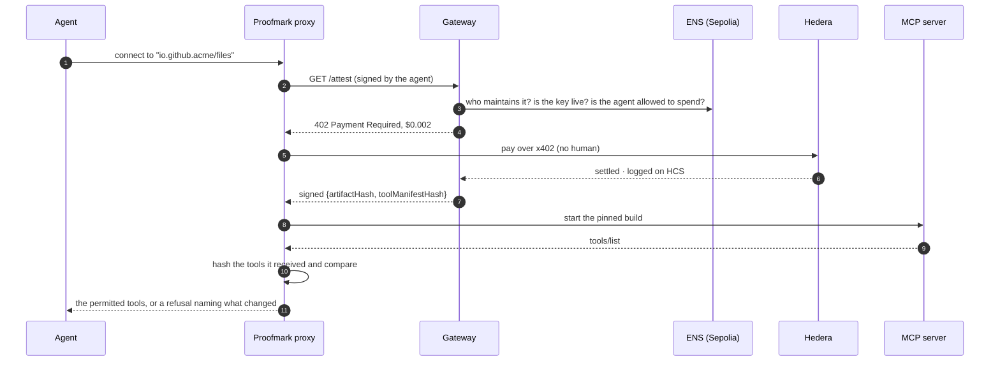

<p align="center">
  
</p>

<h1 align="center">Proofmark</h1>

<p align="center"><strong>The trust gate between AI agents and the MCP servers they connect to.</strong><br/>
x402 payments and audit on Hedera · identity on ENSv2 · uniqueness and spend authority from World</p>

<p align="center">
  <a href="https://proofmark-web.vercel.app">Live app</a> ·
  <a href="https://proofmark-web.vercel.app/check">Check any server</a> ·
  <a href="https://proofmark-web.vercel.app/log">On-chain console</a> ·
  <a href="docs/TESTING.md">Testing report</a> ·
  <a href="docs/WALKTHROUGH.md">Page-by-page walkthrough</a> ·
  <a href="feedback/README.md">Sponsor feedback</a>
</p>

---

## Contents

1. [The idea](#the-idea)
2. [How it works, in one picture](#how-it-works-in-one-picture)
3. [The flows](#the-flows)
4. [Using Proofmark](#using-proofmark)
5. [Proof it runs](#proof-it-runs)
6. [Track requirements](#track-requirements)
7. [Design details](#design-details)
8. [Run it yourself](#run-it-yourself)
9. [Repo map](#repo-map)
10. [Limits, stated plainly](#limits-stated-plainly)
11. [Prior art](#prior-art)
12. [How AI was used](#how-ai-was-used)

---

## The idea

### The problem

An MCP server is not a library. When an agent connects to one, the server is handed the agent's **shell, filesystem, credentials and payment rails**. Thousands of MCP servers already exist, installed with one line such as `npx -y some-server`. Most of them come from people the user has never heard of.

Today the best assurance available is a signature showing that *some GitHub account* built the code. That leaves four gaps:

| Gap | What goes wrong |
| --- | --- |
| **Tools change after approval** | A server that was harmless yesterday quietly adds a `read_env` tool today. Nothing re-checks it. |
| **Accounts are cheap** | One person can run fifty GitHub accounts. A signature binds code to an account, not to anyone accountable. |
| **Nothing revokes** | If a maintainer's key leaks on Tuesday, every agent already connected keeps trusting it. |
| **Nobody pays for checking** | Every verification proposal assumes someone checks for free, forever. In practice nobody does. |

### What Proofmark does

Before an agent connects to an MCP server, Proofmark:

1. **Looks the server up on ENS** to find who maintains it, what they charge, and which key may vouch for it right now.
2. **Pays the maintainer $0.002 over x402 on Hedera**, with no human approving the payment. The agent is allowed to spend because a person approved it once, through a World Agent Pass, and because its operator set an on-chain Hedera allowance.
3. **Gets a signed attestation** of two hashes: the hash of the exact build, and the hash of its exact tool list.
4. **Starts the server and hashes the tools it actually offers.** If the tools differ from what was attested, the connection is refused **before the model ever sees the tool list**.
5. **Keeps watching.** A revoked key reaches every connected agent within seconds through a Hedera Consensus Service topic. ENS is re-read every 15 seconds as the source of truth.

A server is **green** only when its maintainer is backed by all three layers:

```
   ┌────────────────────┐   ┌──────────────────────┐   ┌──────────────────────┐
   │  UNIQUE            │   │  DOMAIN-VERIFIED     │   │  BONDED              │
   │  World ID          │ + │  GitHub gist or      │ + │  50 HBAR in a 2-of-2 │
   │  one person,       │   │  domain proof of the │   │  Hedera account,     │
   │  one claim         │   │  registry namespace  │   │  forfeited on malice │
   └────────────────────┘   └──────────────────────┘   └──────────────────────┘
              stops sockpuppets      ties name to owner      puts money at stake
```

World alone is deliberately **not** trusted for identity. A credential can be shared, so the namespace proof and the bond exist to cover that.

### What Proofmark is not

It is **not a code scanner**. An honest, verified maintainer can still ship a backdoor. Proofmark proves *who stands behind* a build, and that they *still* stand behind it, as of seconds ago. It complements tools like Socket and Snyk; it does not replace them.

---

## How it works, in one picture

```
                                   ┌──────────────────────────────────────────────┐
  ┌──────────────┐   MCP (stdio)   │              PROOFMARK PROXY                 │
  │ Agent client │ ──────────────▶ │  resolve on ENS → pay x402 → verify hashes   │
  │ Claude Code, │ ◀────────────── │  → spawn server → watch for changes          │
  │ Cursor, ...  │  only permitted └───────┬───────────────┬─────────────┬────────┘
  └──────────────┘      tools              │ x402 HTTP     │ spawns      │ subscribes
                                           ▼               ▼             ▼
                ┌──────────────────────────────┐   ┌─────────────┐  ┌──────────────────┐
                │      PROOFMARK GATEWAY       │   │ MCP server  │  │ Hedera mirror    │
                │  Hono · x402 merchant        │   │ (sandboxed  │  │ node: revocation │
                │  attest · claim · revoke     │   │ if unclaimed)│ │ topic messages   │
                └──┬──────────┬──────────┬─────┘   └─────────────┘  └──────────────────┘
                   │          │          │
         ┌─────────▼───┐ ┌────▼──────┐ ┌─▼─────────────┐
         │   HEDERA    │ │  ENSv2    │ │    WORLD      │
         │ x402 settle │ │  Sepolia  │ │ IDKit (claim) │
         │ HCS audit   │ │ orgs,     │ │ Agent Pass    │
         │ HCS revoke  │ │ keys,     │ │ (spend)       │
         │ HTS certs   │ │ agents    │ │               │
         │ allowances  │ │ ERC-8004  │ │               │
         │ bond acct   │ │           │ │               │
         └─────────────┘ └───────────┘ └───────────────┘
```

| Part | Job |
| --- | --- |
| **Proxy** (`apps/proxy`) | What the agent talks to instead of the server. It is the only place enforcement is possible, because a local MCP server runs with the user's full privileges. |
| **Gateway** (`apps/gateway`) | x402 merchant. Sells signed attestations, runs the claim flow, writes ENS, logs to HCS, mints HTS certificates, verifies World proofs. |
| **Worker** (`npm run worker`) | Runs on a machine with Docker. Derives a server's tool manifest inside a no-network sandbox. Holds no keys. |
| **Web app** (`apps/web`) | Marketplace, public `/check`, Fleet, Claim, Maintain, On-chain console, Docs, Pitch. |
| **Agent Kit plugin** (`packages/agent-kit-plugin`) | Lets any Hedera Agent Kit agent check a server and read its own identity. |

### The simple sequence



The same flow without Mermaid:

```
 Agent        Proxy            Gateway             ENS        Hedera        Server
   │  connect   │                 │                 │            │             │
   │──────────▶ │  GET /attest    │                 │            │             │
   │            │───────────────▶ │  read records   │            │             │
   │            │                 │───────────────▶ │            │             │
   │            │  402 · $0.002   │ ◀───────────────│            │             │
   │            │ ◀───────────────│                 │            │             │
   │            │  pay over x402 ────────────────────────────────▶ │             │
   │            │                 │ ◀── settled + HCS log ───────│             │
   │            │  signed hashes  │                 │            │             │
   │            │ ◀───────────────│                 │            │             │
   │            │  start pinned build ───────────────────────────────────────▶ │
   │            │ ◀──────────────────────────────────────── tools/list ────────│
   │            │  hash + compare │                 │            │             │
   │  tools ✓   │                 │                 │            │             │
   │ ◀──────────│   (or ✗ refused, naming the added tool)                      │
```

---

## The flows

### Flow 1 · A maintainer claims a server (about a minute)

```
  Maintainer                         Gateway                               Chains
  ──────────                         ───────                               ──────
  1. Enter registry name ─────────▶  Is it in the official MCP registry?
     connect MetaMask                Does this wallet control the
                                     namespace? (GitHub gist / domain)
                                              │ yes
  2. World ID proof ──────────────▶  Verify proof on the backend,
     (Proof of Human)                reject a reused nullifier
                                              │ valid
  3. Org name, payout   ──────────▶  Register  sam.proofmark.eth  ───────▶  ENSv2 · Sepolia
     account, price                  its own resolver + records            (registry, resolver,
                                     server name → org                      records, roles)
                                              │
  4. Bond: 50 HBAR from payout ───▶  Verify on the mirror node    ───────▶  Hedera
     account to 0.0.11344995         write bond.tx on ENS, log on HCS       (transfer + HCS)
                                              │
                                     Server leaves the sandbox once it has
                                     a live key and an attestation
```

### Flow 2 · A release is attested

```
  ┌───────────────┐  pinned build   ┌──────────────────────────┐   tools/list    ┌────────────┐
  │ MCP registry  │ ──────────────▶ │ Worker (Docker sandbox)  │ ──────────────▶ │ canonical  │
  │ npm / OCI /   │  hash checked   │ --network none           │                 │ SHA-256 of │
  │ mcpb          │  against the    │ --read-only --cap-drop   │                 │ names,     │
  └───────────────┘  registry       └──────────────────────────┘                 │ schemas    │
                                                                                 └─────┬──────┘
          ┌──────────────────────────────────────────────────────────────────────────┘
          ▼
  { server, version, artifactHash, toolManifestHash, attestKey, validUntil }
          │ signed by a co-maintainer key that is live on ENS
          ▼
  Gateway re-checks everything ──▶ full record on HCS ──▶ HTS NFT certificate minted
```

The manifest is **derived, never requested**. Because it comes from running the hash-verified build, a server cannot show one tool list to the attester and another to the user without also changing the build, which the artefact hash catches.

### Flow 3 · An agent connects (the hero flow)

```
   resolve        pay              verify              connect
 ┌─────────┐   ┌─────────┐   ┌──────────────────┐   ┌───────────┐
 │ ENS:    │──▶│ x402 on │──▶│ artefact hash  ✓ │──▶│ session   │
 │ org,    │   │ Hedera  │   │ manifest hash  ✓ │   │ with the  │
 │ price,  │   │ $0.002  │   │ key live       ✓ │   │ permitted │
 │ key     │   │ no human│   │ pass + allowance✓│   │ tools     │
 └─────────┘   └─────────┘   └──────────────────┘   └─────┬─────┘
                                                         │ keeps watching:
                                                         │ • tools/list_changed → re-hash
                                                         │ • HCS revocation topic → seconds
                                                         │ • ENS re-check every 15 s
```

### Flow 4 · The attack is caught

```
  Yesterday (attested)                 Today (served)
  ┌──────────────────────┐             ┌──────────────────────┐
  │ list_dir             │             │ list_dir             │
  │ read_file            │             │ read_file            │
  │                      │             │ read_env   ◀── NEW   │
  └──────────┬───────────┘             └──────────┬───────────┘
             ▼                                    ▼
      0x0e05fb00…72d5f0        ≠           0x9c1a77e2…0b31d4
                          │
                          ▼
     ✗ BLOCKED · manifest-mismatch · "added: read_env"
       The model never sees the tool list. No connection is made.
```

### Flow 5 · Revocation across a fleet

```
  Maintainer revokes bob.acme.proofmark.eth
        │
        ├──▶ ENS: attest.key cleared  (source of truth)
        │
        └──▶ HCS topic 0.0.11344888: {org, key, reason, ts}
                    │
                    │  mirror node subscription (measured 2.1 s)
         ┌──────────┼───────────┬─────────────┐
         ▼          ▼           ▼             ▼
     agent-1    agent-2      agent-3   ...  agent-n      → all go red
     ✗ blocked  ✗ blocked    ✗ blocked      ✗ blocked
     Alice's attestations are untouched: only Bob's key was revoked.
```

### Flow 6 · Spend authority and the denied path

```
                        ┌──────────────── before ANY payment ───────────────┐
  agent asks to pay ──▶ │ World Agent Pass valid and fresh?  ── no ──▶ 403  │ ✗ no payment
                        │ Operator allowance on Hedera left? ── no ──▶ 403  │ ✗ no connect
                        │ Inside the ENS budget?             ── no ──▶ 403  │
                        └──────────────────────┬────────────────────────────┘
                                               │ all yes
                                               ▼
                                     pay $0.002 over x402
```

### The three tiers

```
                    ┌──────────────────────────┐
     name unclaimed │        SANDBOXED         │  runs in a container:
   ───────────────▶ │ --network none --read-only│  read-only tools only
                    └────────────┬─────────────┘
                                 │ claimed + namespace proof + bond + live key
                                 ▼
                    ┌──────────────────────────┐
                    │          GREEN           │  full tool set,
                    │  both hashes match       │  maintainer paid
                    └────────────┬─────────────┘
       hash mismatch · key revoked/expired · bond forfeited · typosquat
                                 ▼
                    ┌──────────────────────────┐
                    │         BLOCKED          │  refused, reason shown,
                    │                          │  alternative offered
                    └──────────────────────────┘
```

There is **no amber tier**. "Pin to the last good version" would let an attacker freeze everyone on a vulnerable build simply by stopping attestation.

---

## Using Proofmark

### If you are a judge: two minutes

1. Open **[/check](https://proofmark-web.vercel.app/check)** and type any MCP server name, for example `io.github.SamuelDharshi/proofmark-files`. You see its tier, its reason and its three layers, all read live from ENS and Hedera.
2. Open **[/log](https://proofmark-web.vercel.app/log)**, the On-chain console. Every payment, HCS message, HTS mint and allowance appears live from the Hedera mirror node. Click any row to open it on HashScan. Press F12 to see each transaction printed to the console.
3. Open **[/marketplace](https://proofmark-web.vercel.app/marketplace)** to browse real registry servers graded green, sandboxed or blocked, with prices in HBAR.
4. Read **[docs/TESTING.md](docs/TESTING.md)** for every transaction from the live test runs.

### If you maintain an MCP server

| Step | Where | What you do | What happens on-chain |
| --- | --- | --- | --- |
| 1 | `/claim` → Server | Press **Connect wallet** (top right). Enter your registry name. Publish the one-line gist the page shows, then **Verify ownership** | Nothing yet. The gateway reads the registry and your gist |
| 2 | `/claim` → Human | Verify with World ID | The proof is checked on the gateway and its nullifier stored |
| 3 | `/claim` → Organisation | Choose an org name, a Hedera payout account and a price | Org, resolver and records written to ENSv2 on Sepolia |
| 4 | `/maintain` → Bond | Send 50 HBAR from your payout account to `0.0.11344995`, paste the transaction id, sign | `bond.tx` on ENS, an HCS audit message |
| 5 | `/maintain` → Co-maintainer | Add a name, a key address and an expiry, then sign | An expiring ENS subname with a role that can only set `attest.key` |
| 6 | `/maintain` → Attest | Start the worker (below), press **Derive, sign and publish**, sign | The full record on HCS, plus an HTS NFT certificate |
| 7 | `/maintain` → Revoke | Revoke a key | One ENS write plus an HCS message. Connected agents block in seconds |

The worker for step 6 runs on your machine, because deriving the manifest needs Docker:

```bash
wsl -u root service docker start        # Windows with Docker in WSL; skip on macOS/Linux
npm run worker -w @proofmark/gateway     # listens on 127.0.0.1:8788, holds no keys
```

All of steps 4 to 6 can also run from a terminal:

```bash
npm run bond:pay -w @proofmark/gateway -- <payout account> <payout key> 50
npm run maintain -w @proofmark/gateway -- <org> <registry name> <label> <days>
```

### If you run agents

1. **Fleet page (`/fleet`):** each agent card shows its ENS name, HCS-14 UAID, ERC-8004 id, budget, operator allowance and Agent Pass.
2. **Get pass:** the gateway starts World's device flow, and you approve once in World. The validated pass is written to the agent's ENS name. Without it, the agent cannot pay, which is the denied path.
3. **Allowance:** approve or withdraw the operator's Hedera allowance to the agent:

   ```bash
   npm run allowance -w @proofmark/gateway -- approve 5     # cap in HBAR
   npm run allowance -w @proofmark/gateway -- withdraw
   ```

4. **Point your agent at the proxy** instead of the server, for example in Claude Code's MCP config:

   ```json
   {
     "mcpServers": {
       "files": {
         "command": "npx",
         "args": ["tsx", "apps/proxy/src/cli.ts",
                  "--server", "io.github.SamuelDharshi/proofmark-files",
                  "--gateway", "https://proofmark-gateway.onrender.com",
                  "--", "npx", "-y", "proofmark-files", "."],
         "env": { "AGENT_ENS_NAME": "claude-1.agents.proofmark.eth" }
       }
     }
   }
   ```

   The agent also gets two tools of its own: `proofmark_explain` (why a server has its tier) and `proofmark_budget` (its spend, caps and pass).

### If you build with the Hedera Agent Kit

```ts
import { proofmarkPlugin } from "@proofmark/agent-kit-plugin";
// adds PROOFMARK_CHECK_SERVER_TOOL and PROOFMARK_AGENT_IDENTITY_TOOL to any Agent Kit agent
```

---

## Proof it runs

Every link below is a real transaction. The full list from the latest runs, including bond, revocation and allowance transactions, is in **[docs/TESTING.md](docs/TESTING.md)**.

**Hedera testnet**

| What | Link |
| --- | --- |
| x402 settlement: agent `0.0.11331191` pays maintainer `0.0.8149406` $0.002 (0.02 HBAR), no human approving | [0.0.7162784-1793921712-374513238](https://hashscan.io/testnet/transaction/0.0.7162784-1793921712-374513238) |
| HCS audit topic: every attestation, payment and identity | [0.0.11331506](https://hashscan.io/testnet/topic/0.0.11331506) |
| HCS revocation topic, subscribed to by proxies | [0.0.11344888](https://hashscan.io/testnet/topic/0.0.11344888) |
| HTS attestation certificates (`PMARK`) | [0.0.11341242](https://hashscan.io/testnet/token/0.0.11341242) |
| Bond account, a 2-of-2 key list | [0.0.11344995](https://hashscan.io/testnet/account/0.0.11344995) |
| A 50 HBAR bond verified; a 5 HBAR one rejected | [verified](https://hashscan.io/testnet/transaction/0.0.8149406-1794004053-697388103) · [rejected](https://hashscan.io/testnet/transaction/0.0.8149406-1794004053-081843488) |
| Operator allowance withdrawn (payment refused), then approved again | [withdraw](https://hashscan.io/testnet/transaction/0.0.8149406-1794004134-445493937) · [approve](https://hashscan.io/testnet/transaction/0.0.8149406-1794004142-331722408) |

**Sepolia (ENSv2 and ERC-8004)**

| What | Link |
| --- | --- |
| Root name | [proofmark.eth](https://sepolia.app.ens.domains/proofmark.eth) |
| Org registry and resolver proxies for an org | [resolver](https://sepolia.etherscan.io/tx/0xc5b8d89f42498ee44f3d51a839b26e54f729ba73b699b7cb685bc5c9dc169783) · [registry](https://sepolia.etherscan.io/tx/0x8a2251888028671212db07806cdf7e1c05c6654436c356721ad5a05a0fbc763e) |
| Co-maintainer added with an expiring key and a role scoped to `attest.key` | [subname](https://sepolia.etherscan.io/tx/0xc31e50cefbafd8fa839132e0d0162546f82f274bd3fca40f53603b63689e6493) · [role](https://sepolia.etherscan.io/tx/0x2aa6372ff2fbbbf94b6852606e64bf93a891f5b78e04480b52f34fda44d92f73) · [key](https://sepolia.etherscan.io/tx/0xd41c46e0276e69d600b14329a5847db8e42de42e3ea466f0ba68145b7b986098) |
| ...and revoked; a connected proxy saw it 2.1 s after the HCS submit | [revoke](https://sepolia.etherscan.io/tx/0xc39e07b54d0e671a332eff6981df0693aedc036c16f6d23ef37c5eebe17f16d7) |
| An unauthorised write to `status` by a co-maintainer | reverts with `EACUnauthorizedAccountRoles` |
| Agent `claude-1.agents.proofmark.eth` registered in the ERC-8004 Identity Registry (#11294) | [register](https://sepolia.etherscan.io/tx/0x24c3a835a1d02dca2439ae61650baca97f129726e9c20902a6c7a12ab221eba8) · [ENS records](https://sepolia.etherscan.io/tx/0x4e85350ffad71f3be6f1042fdae71c364c740283b82f0660d696d4fcc9ff1efa) |

**Automated**

| Suite | Result |
| --- | --- |
| `npm test`: canonical hashing, tiers, typosquats, proxy mismatch refusal, revocation watcher, HCS rebuild | 30 / 30 pass |
| `npm run live:check -w @proofmark/gateway`: the deployed system against both chains and World | 22 / 22 pass |
| `npm run e2e -w @proofmark/gateway`: real bond, revocation, allowance and sandbox transactions | 16 / 16 pass |

---

## Track requirements

### Hedera · AI Agents That Pay: x402

| Requirement | How Proofmark meets it | Code |
| --- | --- | --- |
| x402-protected endpoint settling on Hedera through a listed facilitator | `GET /attest` uses the `@x402/hedera` exact scheme with Blocky402 | [x402.ts](apps/gateway/src/x402.ts) |
| An agent completes a paid request with no human approving | The proxy pays on its own. The Agent Pass and allowance gate *authority to spend*, not each payment | [connect.ts](apps/proxy/src/connect.ts) |
| README with setup, architecture, payment flow and a settled transaction id | This file: [How it works](#how-it-works-in-one-picture), [Flow 3](#flow-3--an-agent-connects-the-hero-flow), [Proof it runs](#proof-it-runs) | |
| Extra: spending controls | Per-payment cap, ENS budget, on-chain operator allowance | [allowance.ts](apps/gateway/src/allowance.ts) |
| Extra: HCS audit log | Attestations, payments, identity, bond and revocation messages | [hcs.ts](apps/gateway/src/hcs.ts) |
| Extra: HCS-14 and ERC-8004 identity | UAID on the agent's ENS name and anchored on HCS; ERC-8004 agent #11294 | [identity.ts](apps/gateway/src/identity.ts) |
| Extra: HTS | Each attestation minted as an NFT certificate | [hts.ts](apps/gateway/src/hts.ts) |
| Extra: Hedera Agent Kit | `@proofmark/agent-kit-plugin` | [packages/agent-kit-plugin](packages/agent-kit-plugin) |

### ENS · Best Use of ENSv2

| Requirement | How Proofmark meets it | Code |
| --- | --- | --- |
| ENSv2 on Sepolia, addresses from the deployments table | Addresses and ABIs load from the deployments export | [deployments.sepolia.json](apps/gateway/ens/deployments.sepolia.json) |
| ENS central, not cosmetic | Every tier decision reads ENS: org, payout, price, keys, bond, domain, agents | [chain.ts](apps/gateway/src/chain.ts) |
| Permissioned Registry, a Permissioned Resolver per org, EAC roles scoped per record | One resolver per org; co-maintainers can only set `attest.key` | [ens.ts](apps/gateway/src/ens.ts) |
| Expiring co-maintainer subnames, surgical revocation | Revoke Bob and Alice's attestations stand | [ens.ts](apps/gateway/src/ens.ts) |
| Wildcard, public read-only page | Any unclaimed name resolves to sandboxed on `/check` | [check.ts](apps/gateway/src/check.ts) |
| Agents as namespaces | `claude-1.agents.proofmark.eth` holds budget, allowed tools, max risk, pass, UAID, ERC-8004 | [chain.ts](apps/gateway/src/chain.ts) |

### World · Agent Pass and IDKit

| Requirement | How Proofmark meets it | Code |
| --- | --- | --- |
| Official Agent Pass, protecting a meaningful action | The protected action is an agent **spending money** and connecting to a server with shell access | [idp.ts](apps/gateway/src/idp.ts) |
| Complete journey | Device flow request → person approves in World → ID token validated on the gateway → pass written to ENS → paid connect | [agents.ts](apps/gateway/src/agents.ts) |
| Denied, expired or cancelled path | No pass, expired pass or a declined request: HTTP 403 before any payment, no connection | [attest.ts](apps/gateway/src/routes/attest.ts) |
| Secure backend validation | RP signing, proof and token checks happen only on the gateway | [world.ts](apps/gateway/src/world.ts) |
| IDKit with a supported credential, verified on the server | Proof of Human (or passport or national ID) on the maintainer claim, with the nullifier checked | [world.ts](apps/gateway/src/world.ts) |
| Why this credential is the minimum sufficient | The trust event is claiming a server name, and it needs one person, one claim. A passport adds friction without proving the holder is the maintainer, so the namespace proof and bond carry identity | [WORLD_DEBRIEF.md](docs/WORLD_DEBRIEF.md) |
| Integration debrief | Time to first success, friction, missing docs, the one improvement | [WORLD_DEBRIEF.md](docs/WORLD_DEBRIEF.md) |

---

## Design details

### The two hashes

| Hash | Source | Catches |
| --- | --- | --- |
| **Artefact** | The registry's integrity field: mcpb `fileSha256`, OCI digest, npm `dist.integrity` | A changed binary |
| **Tool manifest** | SHA-256 over sorted tool names, descriptions and input schemas | The same binary quietly offering a new tool |

Canonicalisation sorts keys, normalises whitespace and strips volatile fields, so honest servers never trip a false mismatch: [canonical.ts](packages/core/src/canonical.ts).

### Rechecks

- **At connect:** both hashes, key liveness, pass and allowance.
- **On every `tools/list_changed`:** re-hash mid-session ([cli.ts](apps/proxy/src/cli.ts)).
- **Revocation topic:** a subscription through the mirror node drops a session within seconds ([revocations.ts](apps/proxy/src/revocations.ts)).
- **Every 15 seconds:** liveness re-read from ENS through the gateway. A missed HCS message only delays a block; it never allows one.
- Each attestation carries `revocationCheckedAt` and a 24-hour `validUntil`, so it goes stale rather than becoming a free pass.

### The ENS tree

```
proofmark.eth                          Permissioned Registry, run by Proofmark
├── *.proofmark.eth                    wildcard: any unclaimed server → sandboxed
├── sam.proofmark.eth                  maintainer org, owned by the claiming wallet
│     status · payto · x402.price · world.verified
│     bond.tx · bond.status · domain.verified
│   ├── main.sam.proofmark.eth         co-maintainer: attest.key, expires in 180 days
│   └── bob.sam.proofmark.eth          co-maintainer: attest.key, revocable alone
├── <server>.proofmark.eth             the server name → resolves to its org
└── agents.proofmark.eth
    └── claude-1.agents.proofmark.eth  agent: budget · allowed.tools · maxrisk
                                       pass.* · hcs14.uaid · erc8004 · operator
```

There is one resolver instance per org, because argument-scoped grants apply to every name an instance serves. Claim and revoke are one write each, and nothing is written per attestation.

### What lives where

| Where | What |
| --- | --- |
| **ENSv2 on Sepolia** | Who may vouch, and whether they still may: orgs, keys, bonds, domains, agents |
| **Hedera HCS** | That it happened, and when: every attestation, payment, identity and revocation, replayable by anyone |
| **Hedera HTS** | A certificate NFT for each attested version |
| **Hedera accounts** | x402 settlement, operator allowances, the 2-of-2 bond account |
| **Gateway** | Only caches. Attestations are rebuilt from HCS after a restart |

---

## Run it yourself

```bash
npm install
cp .env.example .env                                  # fill in the values below
npm run keys -w @proofmark/gateway                    # a signing key for ATTEST_PRIVATE_KEY
npm run hcs:create -w @proofmark/gateway              # HCS_TOPIC_ID
npm run hcs:create -w @proofmark/gateway -- revocations   # REVOKE_TOPIC_ID
npm run hts:create -w @proofmark/gateway              # HTS_TOKEN_ID
npm run bond:create -w @proofmark/gateway             # BOND_ACCOUNT_ID
npm run ens:status -w @proofmark/gateway              # confirms the admin wallet owns the root name
npm run agents:create -w @proofmark/gateway -- 2 5 1  # 2 agents, 5 HBAR each, $1 budget
npm run gateway                                       # http://localhost:8787
npm run web                                           # http://localhost:3000
npm test                                              # 30 unit tests
npm run live:check -w @proofmark/gateway              # the deployed system, end to end
```

| Account | What you need |
| --- | --- |
| Hedera | A testnet account with an ECDSA key: the gateway payee, HCS submitter and funder |
| ENS | A Sepolia wallet that owns the root name, with Sepolia ETH |
| World Agent Pass | An OIDC client from the [World IdP portal](https://auth.world.org/portal) |
| World IDKit | An app, RP id and signing key from the [Developer Portal](https://developer.world.org) |
| Docker | Only on the machine that runs the attestation worker |

---

## Repo map

```
packages/core              canonical manifest hash, tier policy, typosquat check, explorer links
packages/runner            spawns an MCP server, in a hermetic container when available
packages/agent-kit-plugin  Hedera Agent Kit plugin
apps/gateway               Hono gateway: x402, attest, HCS, HTS, ENS, World, claim, bond, revoke
apps/gateway/src/scripts   live:check, e2e, worker, maintain, bond, allowance, setup scripts
apps/proxy                 the MCP proxy agents connect through
apps/demo-server           MCP test fixture for the proxy tests (the read_env attack)
apps/web                   Next.js app: landing, marketplace, check, fleet, claim, maintain, on-chain, docs, pitch
publish/files-server       proofmark-files, a real server published to npm and the MCP registry
docs                       TESTING.md, WALKTHROUGH.md, WORLD_DEBRIEF.md, architecture diagram
feedback                   one FEEDBACK.md per sponsor: Hedera, ENS, World
```

---

## Limits, stated plainly

- **Not a scanner.** A verified maintainer can still ship malicious code. Proofmark makes that attack cost a unique identity, a namespace and a bond, keeps it revocable, and leaves a record.
- **Hosted remote servers** get liveness, identity and revocation, but no integrity guarantee. A remote endpoint can show the attester a different face. Clients report the hashes they observe so divergence is flagged.
- **The gateway is trusted** to run the sandboxed derivation honestly and to mark a bond forfeited. A contract or HTS escrow for the bond is the next step.
- **World proves uniqueness, not identity.** A shared credential is a known weakness, which is why the namespace proof and the bond exist.

---

## Prior art

| Work | What it does | What it leaves open |
| --- | --- | --- |
| [Stacklok ToolHive](https://stacklok.com/blog/from-unknown-to-verified-solving-the-mcp-server-trust-problem/) | Sigstore signatures and build attestations on MCP images before deploy | No revocation, no identity beyond a GitHub account, nothing after deploy |
| [Tool-definition hash pinning](https://codeongrass.com/blog/mcp-tool-shadowing-defenses-detect-poisoned-descriptions/) | Canonical SHA-256 over tool definitions | Nobody ships or signs it; nothing binds it to a person |
| [Official MCP registry](https://modelcontextprotocol.io/registry/about) | Verifies name ownership. Proofmark uses it | No signing, no revocation, no identity |
| [A trustworthy MCP registry](https://www.mdpi.com/1999-5903/18/5/243) | Sigstore signing plus runtime JWS | No revocation, no human identity, no payments |

Proofmark adds three narrow things: **revocation that reaches a running fleet**, a **unique, domain-verified, bonded maintainer** instead of one account, and a **recurring payment** that keeps the freshness check sustainable.

---

## How AI was used

Following ETHGlobal's rules: an AI coding assistant (Claude Code) was used throughout, to write and refactor code, tests and documentation, to run the on-chain test scripts, and to draft the pitch decks. The architecture, the product decisions and every on-chain approval were made by the team. Every transaction listed above was checked on HashScan or Etherscan.

## Credits

Marks for Hedera, ENS, World, MetaMask and the Model Context Protocol belong to their owners and appear here only to show the technology Proofmark is built with.
