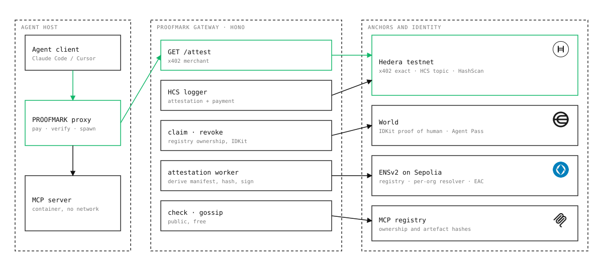
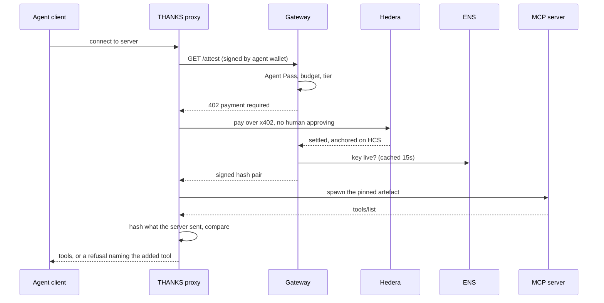
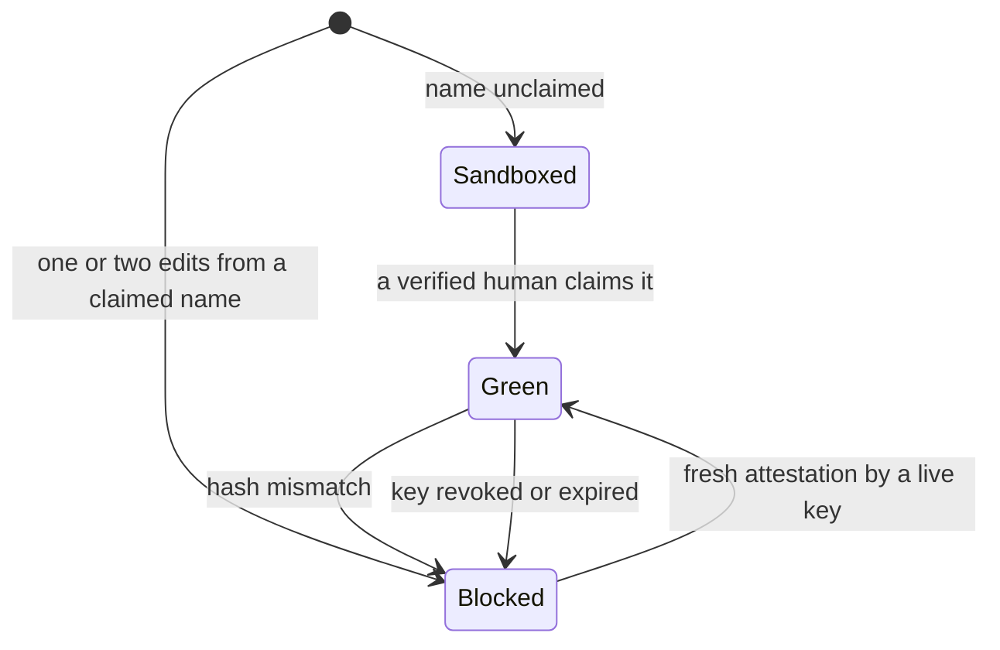

<p align="center">
  
</p>

<h1 align="center">THANKS</h1>

<p align="center"><strong>A human still backs this server. x402 on Hedera.</strong></p>

THANKS is an MCP trust gate. Before an agent connects to an MCP server, which gets shell, filesystem and credential access, it pays $0.002 over x402 on Hedera for a fresh attestation that a verified human still stands behind this exact build and these exact tools. If the server later advertises a tool it did not have when it was attested, the hashes diverge and the connection is refused before the model sees the tool list. If a maintainer's key is revoked, running agents block on their next check.

It is an MCP proxy, a Hono gateway that is an x402 merchant, an attestation worker, and a Next.js app with a marketplace, a public `/check` page and a fleet view.

<p align="center"></p>

## Proof it runs

Everything below is reproducible from a clean clone.

**Live on Hedera testnet**

| What | Link |
| --- | --- |
| x402 settlement, agent `0.0.11331191` pays maintainer `0.0.8149406` $0.002 (0.02 HBAR), no human approving | [HashScan transaction](https://hashscan.io/testnet/transaction/0.0.7162784-1793919934-059482907) |
| HCS topic holding every attestation and payment | [Topic 0.0.11331162](https://hashscan.io/testnet/topic/0.0.11331162) |
| Maintainer account | [0.0.8149406](https://hashscan.io/testnet/account/0.0.8149406) |
| Paying agent account | [0.0.11331191](https://hashscan.io/testnet/account/0.0.11331191) |

| What | How to see it |
| --- | --- |
| Derived manifest hash and mismatch refusal | `npm test`. The proxy suite runs the real demo MCP server clean, then mutated, and asserts the refusal names `read_env` |
| x402 settlement on Hedera testnet | Connect one agent. The proxy logs a HashScan link for the settled transaction and the gateway records it on the Fleet page |
| Public replayable log | The HCS log page reads the topic back from the Hedera mirror node. The topic link is returned by `GET /config` |
| ENSv2 hierarchy | `GET /config` returns the contract addresses used. Each org, co-maintainer and revocation links to Sepolia Etherscan and the ENS app |
| Denied path | Fleet, Agents tab: expire an agent's pass, then connect. The payment is refused and no connection is made |
| Public read-only page | `/check` resolves any server name. Unclaimed names honestly return sandboxed |

## Track requirements

| Partner | Requirement | How THANKS meets it | Code |
| --- | --- | --- | --- |
| Hedera | x402-protected endpoint settling on Hedera testnet through a listed facilitator | `GET /attest` uses `@x402/hedera` exact scheme with the Blocky402 facilitator | [x402.ts:33](apps/gateway/src/x402.ts#L33), [x402.ts:69](apps/gateway/src/x402.ts#L69) |
| Hedera | A paid request with no human approving | The proxy signs and pays on its own. The Agent Pass gates authority to spend, not each payment | [connect.ts:48](apps/proxy/src/connect.ts#L48), [attest.ts:31](apps/gateway/src/routes/attest.ts#L31) |
| Hedera | HCS audit topic | Every attestation and every settled payment is one HCS message | [hcs.ts:27](apps/gateway/src/hcs.ts#L27), [x402.ts:37](apps/gateway/src/x402.ts#L37) |
| Hedera | Per-run budget and approval threshold | Budget lives on the agent record and is enforced before payment | [attest.ts:31](apps/gateway/src/routes/attest.ts#L31) |
| ENS | ENSv2 on Sepolia, addresses from the deployments table | Addresses and ABIs load from an export of the deployments table | [ens.ts](apps/gateway/src/ens.ts), [deployments.sepolia.json](apps/gateway/ens/deployments.sepolia.json) |
| ENS | Permissioned Registry, per-maintainer Permissioned Resolver, EAC roles scoped per record key | One resolver proxy per org. Co-maintainers get a setter role for `attest.key` only | [ens.ts:103](apps/gateway/src/ens.ts#L103), [ens.ts:133](apps/gateway/src/ens.ts#L133) |
| ENS | Expiring co-maintainer subnames, surgical revocation | Subname registered with an expiry. Revocation is one write | [ens.ts:150](apps/gateway/src/ens.ts#L150) |
| ENS | An unauthorised write reverts | `eth_call` as the co-maintainer writing `status` returns `EACUnauthorizedAccountRoles` | [ens.ts:159](apps/gateway/src/ens.ts#L159) |
| ENS | Wildcard resolution, public read-only page | Any unclaimed name resolves to sandboxed on `/check` | [check.ts](apps/gateway/src/check.ts) |
| ENS | Reads cached 15s, invalidated on `TextUpdated` and `EACRolesChanged` | Cache plus chain event watchers | [ens.ts:188](apps/gateway/src/ens.ts#L188) |
| World | Agent Pass integrated, spend authority depends on it | AgentBook lookup gates every payment | [agents.ts:37](apps/gateway/src/agents.ts#L37) |
| World | Denied path | Expired or revoked pass: payment refused, no connection | [attest.ts:31](apps/gateway/src/routes/attest.ts#L31) |
| World | IDKit Proof of Human on the claim, duplicate nullifier rejected | Backend verification, nullifier stored per action | [world.ts:39](apps/gateway/src/world.ts#L39) |
| World | Validation on a secure backend | RP signing and proof verification run only on the gateway | [world.ts:10](apps/gateway/src/world.ts#L10) |

## How it works



### The two hashes

| Hash | Source | Catches |
| --- | --- | --- |
| Artefact | Registry integrity field: mcpb `fileSha256`, OCI digest, npm `dist.integrity` | A changed binary |
| Tool manifest | SHA-256 over sorted tool names, descriptions and input schemas | The same binary quietly offering a new tool |

The manifest is derived, never requested. The attestation worker fetches the pinned artefact, verifies its hash, runs it with no network and captures `tools/list` itself, so a split view implies a different binary. Canonicalisation sorts keys, normalises whitespace and strips volatile fields: [canonical.ts](packages/core/src/canonical.ts).

### Rechecks

The proxy checks at connect, again on every `notifications/tools/list_changed` ([cli.ts:103](apps/proxy/src/cli.ts#L103)), and re-checks liveness against the gateway every 15 seconds. Every attestation carries `revocationCheckedAt` and a 24 hour `validUntil`, so a cached one is evidence that goes stale rather than a free pass.

### Tiers



There is no amber tier. Pinning to the last attested version would let an attacker freeze everyone on a vulnerable build by stopping attestation. Policy: [tiers.ts](packages/core/src/tiers.ts).

### ENS tree

```
thanks.eth                     Permissioned Registry, administered by THANKS
  acme.thanks.eth              maintainer org, owned by the claiming human
      status, payto, x402.price, world.verified
    alice.acme.thanks.eth      co-maintainer: attest.key, expires
    bob.acme.thanks.eth        co-maintainer: attest.key, expires
```

One resolver instance per org, because argument-scoped grants apply to every name an instance serves. Claim and revoke are one write each. Nothing is written per attestation.

## Sponsor integrations

### Hedera
`@x402/hedera` exact scheme on `hedera:testnet`, settled by the Blocky402 facilitator. The price and `payTo` account are set per maintainer and capped at $0.05 ([x402.ts:69](apps/gateway/src/x402.ts#L69)). The asset is configurable and defaults to HBAR, because testnet USDC token ids are not reliable across facilitators. HCS carries every attestation and payment ([hcs.ts](apps/gateway/src/hcs.ts)). Every transaction id in the app links to HashScan.

### ENS
ENSv2 on Sepolia: Permissioned Registry subname registries, a Permissioned Resolver per org, Enhanced Access Control roles scoped to `attest.key`, expiring co-maintainer subnames and wildcard resolution to the sandboxed tier ([ens.ts](apps/gateway/src/ens.ts)).

### World
Agent Pass (AgentKit and AgentBook) proves a verified human operates the paying agent. IDKit Proof of Human gates the maintainer claim, one nullifier to one identity. For a maintainer, uniqueness is the property needed, and a passport-grade credential would break the pseudonymity open source relies on. For the agent, the pass only has to show that some verified human is accountable for it ([world.ts](apps/gateway/src/world.ts), [agents.ts](apps/gateway/src/agents.ts)).

### MCP
Name ownership uses the official registry's own verification: `mcpName` in package.json, an `mcp-name:` README line or an OCI label ([registry.ts](apps/gateway/src/registry.ts)).

## Prior art

| Work | What it does | What it leaves open |
| --- | --- | --- |
| [Stacklok ToolHive](https://stacklok.com/blog/from-unknown-to-verified-solving-the-mcp-server-trust-problem/) | Verifies Sigstore signatures and build attestations on MCP images before deployment | No revocation, no human identity beyond a GitHub account, nothing once deployed |
| [Tool-definition hash pinning](https://codeongrass.com/blog/mcp-tool-shadowing-defenses-detect-poisoned-descriptions/) | Canonical SHA-256 over tool names, descriptions and schemas | Nobody ships or signs it, nothing binds it to a person |
| [Official MCP registry](https://modelcontextprotocol.io/registry/about) | Verifies name ownership | No signing, no revocation, no identity |
| [A trustworthy MCP registry](https://www.mdpi.com/1999-5903/18/5/243) | Sigstore signing plus runtime JWS | No revocation, no human identity, no payments |

THANKS adds three narrow things: revocation that reaches a running fleet, one human instead of one account, and a recurring payment that makes the freshness check sustainable.

## Run it

```bash
npm install
cp .env.example .env          # fill in the values
npm run keys -w @thanks/gateway          # prints fresh signing and agent keys
npm run hcs:create -w @thanks/gateway    # prints HCS_TOPIC_ID
npm run gateway               # http://localhost:8787
npm run web                   # http://localhost:3000
npm test                      # core and proxy suites
```

Try the whole flow before World and ENS are set up. The seed claims the bundled demo servers in the local store, marked not human-verified, and anchors their attestations on HCS:

```bash
npm run seed:demo -w @thanks/gateway      # claim and attest the demo servers
npm run agents:create -w @thanks/gateway -- 2   # funded testnet agents, with the gateway running
npm run connect:demo -w @thanks/proxy     # one paid connect through the real proxy code
```

Point an agent client at the proxy instead of the server:

```json
{
  "mcpServers": {
    "filesystem": {
      "command": "npx",
      "args": ["tsx", "apps/proxy/src/cli.ts", "--server", "io.thanks.demo/filesystem",
               "--gateway", "http://localhost:8787", "--artifact", "apps/demo-server/src/server.ts",
               "--", "npx", "tsx", "apps/demo-server/src/server.ts"]
    }
  }
}
```

## Repo map

```
packages/core      canonical manifest hash, tier policy, typosquat check, explorer links
packages/runner    spawn an MCP server, in a hermetic container when one is available
apps/gateway       Hono gateway: x402, attestation worker, HCS, ENS, World, claim, revoke
apps/proxy         the MCP proxy agents connect through
apps/demo-server   a filesystem MCP server with a live tool-mutation toggle
apps/web           Next.js app: landing, marketplace, inspector, check, fleet, claim, docs
docs               architecture diagram
```

## Credits

Marks for Hedera, ENS, World and the Model Context Protocol belong to their owners and appear here only to show the technology THANKS is built with.
